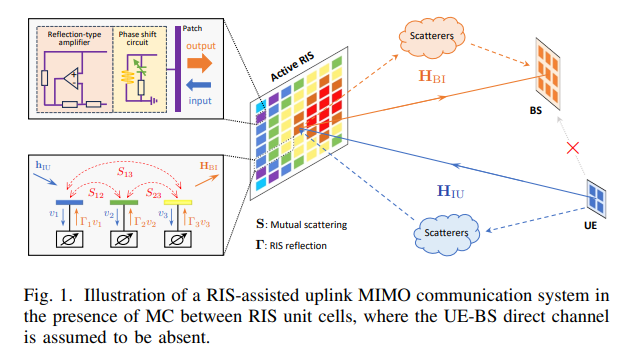
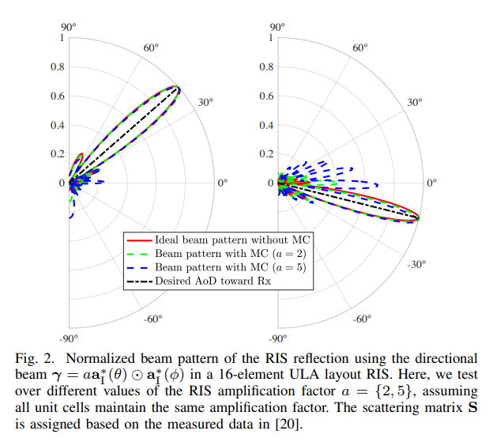
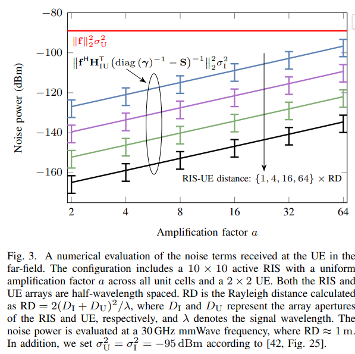
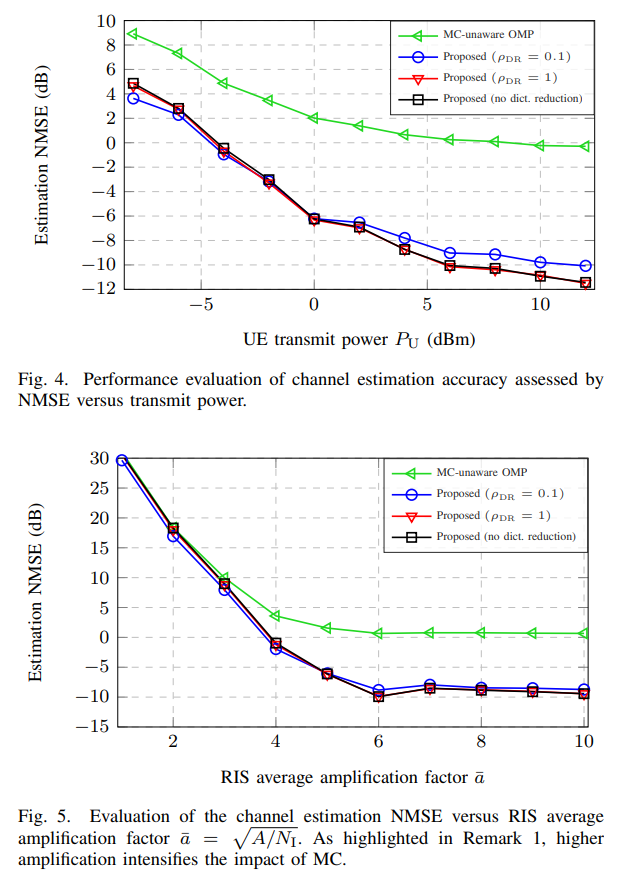
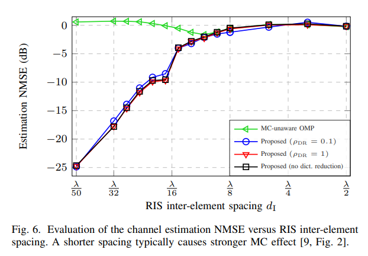
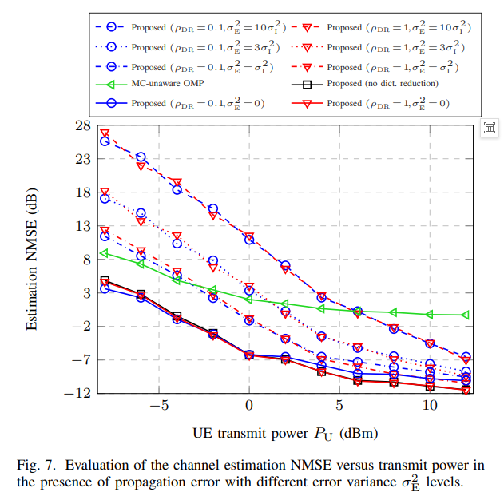
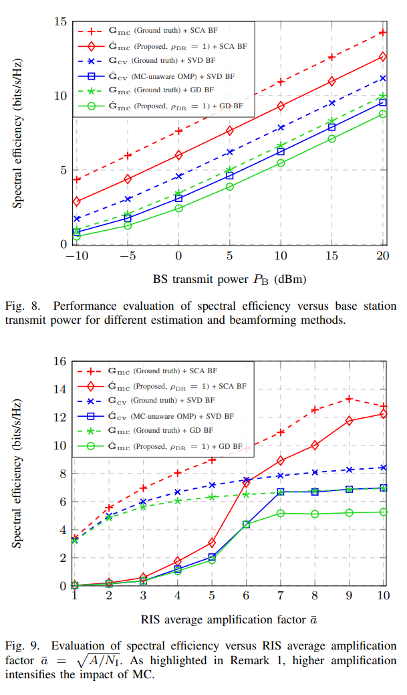

# [RIS] Channel Estimation and Beamforming Considering Mutual Coupling Effects in Assisted Communication with RIS [Attached MATLAB Code]

This paper investigates the channel estimation and beamforming problems for multi-input multi-output (MIMO) communication with active reconfigurable intelligent surfaces (RIS), incorporating mutual coupling (MC) effects into an electromagnetic consistency model. The study shows that MC effects can be integrated into the compression sensing (CS) framework, but this increases the dimensionality of the sensing matrix. To reduce complexity, a two-stage strategy is proposed: first, obtain a preliminary channel estimate through low-complexity mutual coupling-independent CS estimation, and then use this estimate to perform dictionary reduction (DR), achieving mutual coupling-aware estimation. This approach maintains the accuracy of direct mutual coupling-aware CS methods while reducing computational complexity. Additionally, for single-user MIMO systems, the joint optimization problem of RIS configuration, base station precoding, and user combining is studied. An alternating optimization strategy is employed, and a novel RIS configuration optimization algorithm based on successive convex approximation (SCA) and the Noyce-Levenberg-Marquardt (NLMP) method is proposed. Numerical results validate the effectiveness of the proposed scheme, demonstrating higher spectral efficiency in RIS MC scenarios compared to existing mainstream solutions.
Introduction: The next-generation wireless network aims to enhance spectral and energy efficiency, necessitating the integration of transformative technologies. To achieve rich bandwidth, networks are shifting towards higher frequency bands such as millimeter waves (mmWave) and terahertz (THz), but these frequencies are susceptible to blockage, leading to reduced link availability. Reconfigurable intelligent surfaces (RIS) offer a viable solution as planar metamaterial surfaces composed of nearly passive reflective units, effectively mitigating the aforementioned issues. Active RISs, by integrating reflective amplifiers, effectively alleviate the multiplicative fading effects, breaking through the capacity limitations of passive RISs. Dense and all-dielectric RISs, with their flexible and precise electromagnetic wave control capabilities and high energy efficiency, have received widespread attention, but these new RIS designs also pose new challenges, particularly the mutual coupling (MC) effect. Studies have shown that the layout density of RIS units can enhance inter-unit mutual coupling, while increasing the RIS amplification coefficient further exacerbates the MC effect, reducing channel estimation and positioning accuracy. Therefore, precise modeling and complex signal processing are crucial for optimizing RIS communication performance and fully leveraging its electromagnetic interaction potential.
Related work mainly falls into four directions: Traditional RIS modeling often adopts linear series-parallel channel models, assuming each RIS unit radiates independently, overlooking the nonlinear mutual coupling effects between adjacent units, making it difficult to reflect physical reality; Mutual coupling-aware RIS modeling includes the PhysFad model based on coupled dipole formalism and the impedance matrix and scattering matrix (S-parameters) models based on microwave multiport network theory; In the field of channel estimation, existing methods based on compression-sensing are mostly based on traditional linear models, not considering mutual coupling effects, and few studies involving mutual coupling have shown that dictionary learning is an effective tool; In terms of beamforming, there has been more research on RIS beamforming based on traditional models, but considering mutual coupling is still in its infancy, and does not fully cover the scenario of active RISs.
This paper is the first to comprehensively consider the issue of channel estimation and beamforming for active RIS-assisted communication when there are mutual coupling between RIS units. It constructs solutions under both uplink and downlink communication paradigms, with main contributions including: constructing and solving the problem of active RIS-assisted channel estimation considering mutual coupling; proposing a new CS formula; reducing the complexity of mutual coupling-perceived channel estimation through dictionary reduction strategies; building and solving joint optimization problems for RIS configuration, base station precoding, and user combiners based on the estimated equivalent cascaded channels; validating the superiority of the proposed method through extensive numerical simulations.
Method Introduction Channel Estimation Method 1
Intercoupling Perception CS Formula Construction: By appropriately handling observation formats, the intercoupling effect is incorporated into the compression-sensing framework. Without sacrificing accuracy, an equivalent cascade channel estimation problem is solved based on the Orthogonal Matching Pursuit (OMP) algorithm, which can meet subsequent beamforming design requirements.
2  
Two-stage Low Complexity Estimation Strategy: In the first stage, a traditional CS estimation is used to obtain a rough channel estimate; in the second stage, this rough estimate is utilized to design a dictionary reduction process. From the dictionary of the intercoupling perception model, key atoms are selected and a compact dictionary is constructed, effectively counteracting the dimension increase brought by intercoupling and reducing computational complexity.
Beamforming method 1
Joint Optimization Framework: Based on the estimated equivalent cascaded channels, construct a joint optimization problem for RIS configuration, base station precoding, and user combiner. Utilize an alternating optimization strategy to iteratively optimize three beamformers until the objective function converges.
2  
Component optimization schemes: Base station precoding and user combiners can obtain closed-form optimal solutions through alternating projection or singular value decomposition (SVD); In RIS configuration optimization, the objective function is approximated using the Neumann series expansion, transforming the non-convex problem into a manageable form. Subsequently, a convex approximation function is constructed through a successive convex approximation (SCA) framework, which meets both convexity and equal gradient conditions. This is then solved by combining with the KKT conditions and binary search.
Conclusion: This paper focuses on active RIS-assisted MIMO systems with mutual coupling effects, thoroughly investigating channel estimation and beamforming techniques. The study shows that despite the increased complexity brought by mutual coupling, by exploiting the inherent structure of signals, it is possible to efficiently convert mutually coupled channel estimation into a compressed sensing problem. By integrating dictionary reduction techniques, robust and low-complexity channel estimation can be achieved, maintaining good performance even in strong mutual coupling scenarios.
In terms of beamforming, an algorithm for mutually coupled perception based on the Noyce expansion and a successive convex approximation optimization framework effectively addresses the non-convexity and difficult handling issues of RIS configuration optimization. Key findings indicate that mutual coupling has a dual role: while traditionally considered a performance limiting factor, this study demonstrates that through precise modeling and rational utilization, mutual coupling can become a catalyst for performance enhancement.
Numerical simulations show that spectral efficiency is highly sensitive to design parameters related to mutual coupling such as the RIS amplifying coefficient and cell spacing. At medium ranges (e.g., λ/16 to λ/8), mutual coupling can have a positive effect, leading to significant performance gains. This indicates that for RIS designs considering mutual coupling, there might be optimal RIS densities and amplification levels that balance the signal distortion caused by mutual coupling with constructive effects. Overall, this paper confirms that through meticulous modeling and effective utilization, mutual coupling is not merely a source of performance degradation but also presents opportunities for the design of next-generation RIS-assisted communication systems.
End

## Images

<!-- PAYMENT_BLOCK -->

## Get this dataset

- Payment link (Stripe): [Buy now](https://buy.stripe.com/3cs8yP7sY87d0vu9AB)
- Payment QR code: 

<!-- /PAYMENT_BLOCK -->
